# The 24 viewpoints

Every emoji in nutmap was described 24 times, once from each viewpoint below, by `claude-haiku-5-5`. Each description comes with keywords and up to eight linked emoji, each with a reason for the link. Together the descriptions make up most of the race similarity, and each viewpoint's descriptions alone also get a map of their own.

For every viewpoint, this page shows the instruction it was given, its map, and what it said about 🌰 chestnut and 🐉 dragon. [The viewpoint tour](https://www.youtube.com/watch?v=_otlOBEtCgg) plays the maps in motion, and [the interactive map](https://nutmap.ic-rbow.workers.dev) switches between them.

## The prompt

Every request had the same system prompt, with the viewpoint's title and instruction filled in:

```text
You are one member of a panel that describes emoji. Every member looks at the emoji from a different viewpoint.

Your viewpoint: {title}. {instruction}

For the emoji you are given, return JSON with:
- "description": 2 to 4 sentences describing the emoji strictly from your viewpoint.
- "keywords": up to 8 short keywords from your viewpoint.
- "links": 3 to 8 other standard Unicode emoji that this emoji naturally leads to from your viewpoint. Each link has "emoji" (exactly one emoji and nothing else, no words) and "relation" (a short phrase under 12 words saying how the two connect). Never link the emoji to itself.
```

The emoji came in the user message. For 🌰 it read:

```text
Emoji: 🌰
Name: chestnut
Keywords: almond, chestnut, plant
Category: Food & Drink / food-vegetable
```

The answer had to be JSON with exactly those three fields.

## The blended map

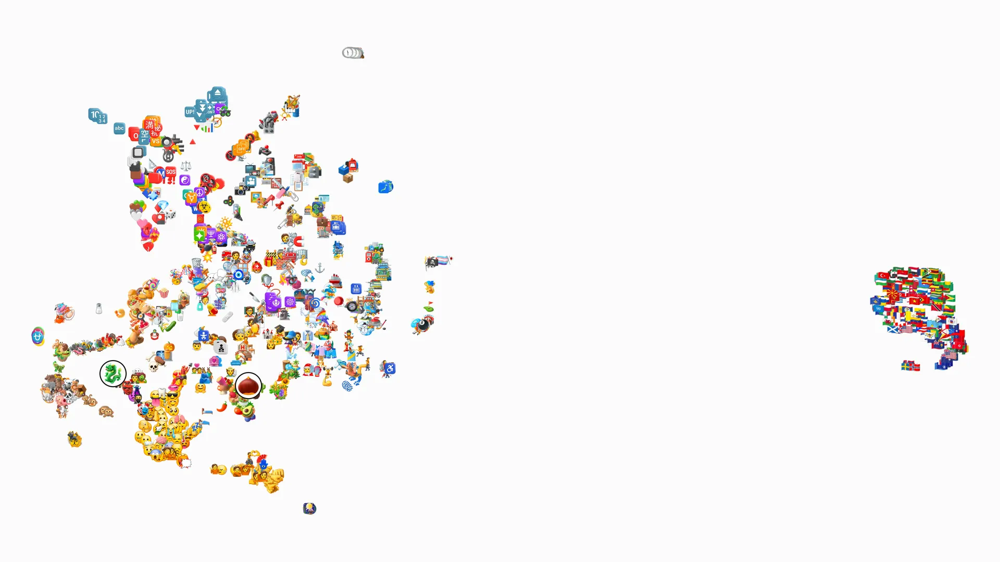

The blended map places every emoji by all 24 of its descriptions pooled together. Each viewpoint's map grew out of it through a sweep of aligned UMAP layouts, so an emoji tends to sit in a similar place on every map. 🌰 and 🐉 are circled on all of them.

No flat map keeps every neighbourhood: the blended map keeps 51% of each emoji's 15 nearest neighbours.

## At a glance

Take each emoji's 15 nearest neighbours by one viewpoint's descriptions. *Shared* is how many of them the blended descriptions also have; *kept* is how many the viewpoint's own map keeps.

| Viewpoint | Shared | Kept |
| --- | ---: | ---: |
| [Literal depiction](#literal-depiction) | 57% | 48% |
| [Colour and shape](#colour-and-shape) | 38% | 41% |
| [Taxonomist](#taxonomist) | 62% | 56% |
| [Chef](#chef) | 49% | 44% |
| [Naturalist](#naturalist) | 51% | 47% |
| [Five-year-old](#five-year-old) | 55% | 45% |
| [Texting and internet slang](#texting-and-internet-slang) | 52% | 38% |
| [Emotional vibe](#emotional-vibe) | 44% | 41% |
| [Seasons and holidays](#seasons-and-holidays) | 53% | 46% |
| [Japanese origin](#japanese-origin) | 55% | 42% |
| [Cross-cultural meanings](#cross-cultural-meanings) | 57% | 45% |
| [Storyteller](#storyteller) | 49% | 42% |
| [Punster](#punster) | 52% | 37% |
| [Historian](#historian) | 58% | 43% |
| [Material and senses](#material-and-senses) | 47% | 44% |
| [Scale and physics](#scale-and-physics) | 45% | 45% |
| [Trade and economy](#trade-and-economy) | 51% | 48% |
| [Game designer](#game-designer) | 52% | 46% |
| [Poet](#poet) | 48% | 40% |
| [Jobs and workplaces](#jobs-and-workplaces) | 55% | 48% |
| [Sports and play](#sports-and-play) | 54% | 44% |
| [Body and health](#body-and-health) | 53% | 47% |
| [Where you would find it](#where-you-would-find-it) | 54% | 49% |
| [Free word association](#free-word-association) | 54% | 42% |

## Literal depiction

> Describe exactly what is drawn: the object, figure or symbol, its parts and pose, as if explaining the picture to someone who cannot see it.

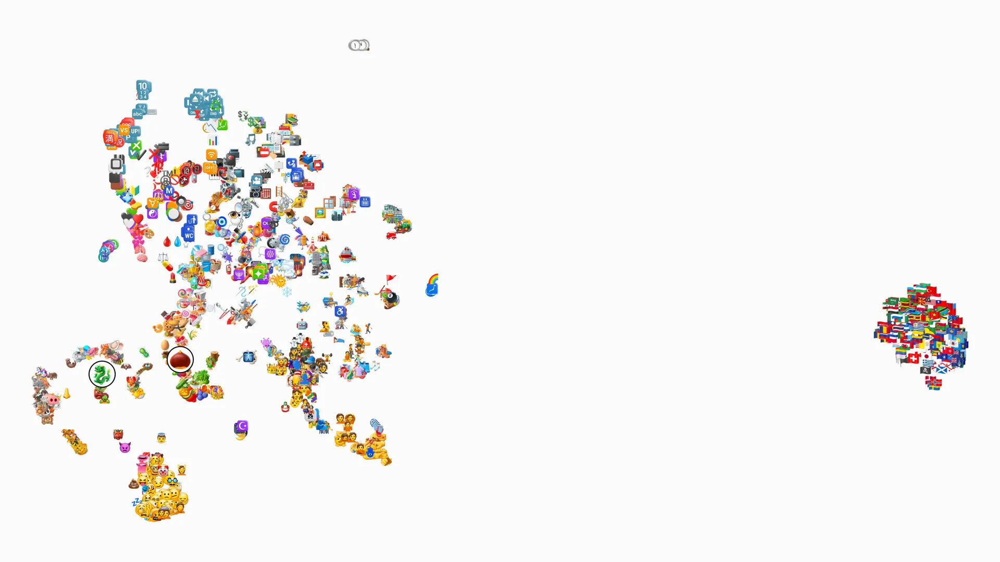

Shares 57% of each emoji's nearest neighbours with the blended descriptions; its map keeps 48%.

**🌰 chestnut.** The chestnut emoji shows a single brown, glossy, rounded nut with a flattened base and a pointed tip. Its smooth shell has a small pale tuft or scar near the top, giving it a seed-like look. It is shown alone against a plain background, with no leaves or spiky husk visible.

Keywords: chestnut, nut, brown, seed, roasted, autumn, shell, round.

- 🍂 fallen autumn leaves where chestnuts drop
- 🌳 deciduous tree that bears chestnuts
- 🥜 another nut, similar brown shell
- 🍁 maple leaf, a fall foliage companion
- 🎃 jack-o'-lantern, a seasonal autumn treat theme
- 🍄 mushroom found on the forest floor in autumn

Nearest by these descriptions: 🥜 🥥 🏵️ 🍄‍🟫 🥔 🍪 🫘 🥯

**🐉 dragon.** A green dragon shown from the side, with a long serpentine body curling across the image. It has a horned head with an open mouth and visible teeth, folded or spiky wings on its back, and a long tail ending in a pointed tip. Its legs are short and clawed, giving it a crouched, ready-to-attack pose.

Keywords: dragon, reptile, wings, horns, serpent, tail, fantasy, fire-breathing.

- 🦎 both are scaly reptiles with long tails
- 🐍 both have long serpentine bodies
- 🏰 dragons often guard castles in fairytales
- 🤴 princes in tales often battle dragons
- 🔥 dragons are often depicted breathing fire
- 🦖 both are large scaly reptilian creatures

Nearest by these descriptions: 🐲 🐊 🐍 🦕 🦖 🐦‍🔥 🦎 🦂

## Colour and shape

> Ignore meaning. Describe only colours, silhouette, geometry, proportions and visual texture. Link to emoji that look alike.

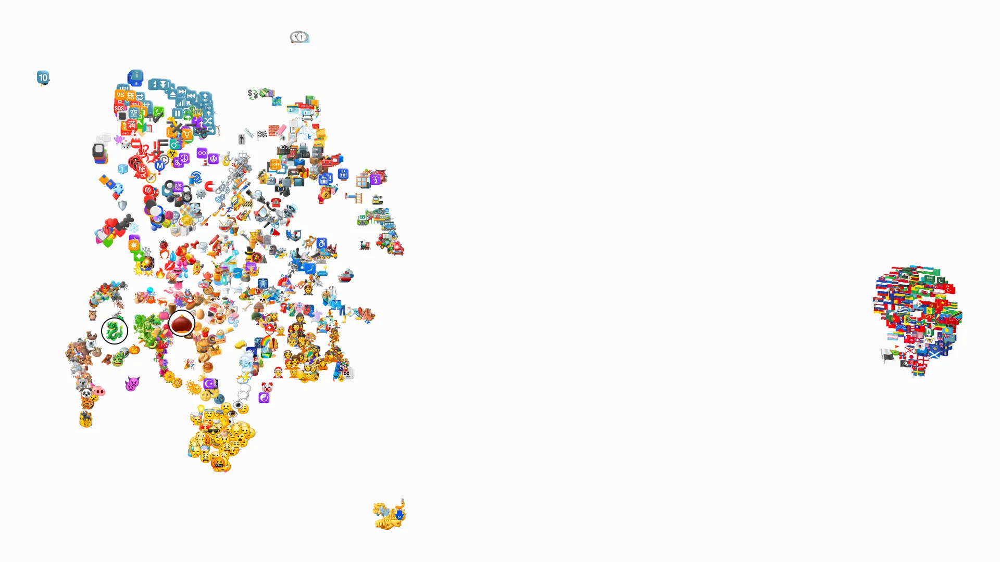

Shares 38% of each emoji's nearest neighbours with the blended descriptions; its map keeps 41%.

**🌰 chestnut.** The chestnut emoji is a small, oval, rounded body in a warm glossy brown with a slightly darker pointed tip at one end. Its silhouette is compact and convex, with a smooth, shiny surface broken by a few subtle highlights. A thin, lighter brown outline and a faint pale seam suggest its shell's contour without strong detail.

Keywords: brown, oval, glossy, rounded, pointed tip, compact, smooth, seam.

- 🥜 similar brown oval nut shape and size
- 🫘 matching brown oval bean silhouette
- 🥔 similar brown tuber body with earthy tone
- 🌑 round dark form with a shiny surface
- 🥥 brown rounded shell with a textured exterior
- 🟤 shares the same solid brown colour

Nearest by these descriptions: 🥥 🫜 🐻 🪎 🦪 🧺 🍄‍🟫 🫈

**🐉 dragon.** The dragon is a green-bodied creature with a serpentine, sinuous silhouette that curves in an S-shape across the frame. Its body shows darker green shading along the back and a lighter cream-yellow belly, with spiky ridges running along the spine and a pair of wide wing-like fins. The outline is dominated by rounded curves and sharp pointed spikes, giving a contrast between soft forms and angular protrusions.

Keywords: green, serpentine, S-curve, spiky ridges, wings, cream belly, sinuous, angular spikes.

- 🦖 shares green reptilian body with spiky back ridges
- 🐲 same green dragon head silhouette with spikes
- 🦕 long serpentine neck and tail silhouette in green
- 🐍 sinuous curving body outline in green tones
- 🦎 green scaled reptile with similar elongated body
- 🐊 dark green elongated body with textured scaly surface

Nearest by these descriptions: 🐍 🐲 🐊 🐛 🦎 🐢 🦗 🦕

## Taxonomist

> Classify the thing: what kind of thing it is, its category, what it is a member of, and its closest siblings in that classification.

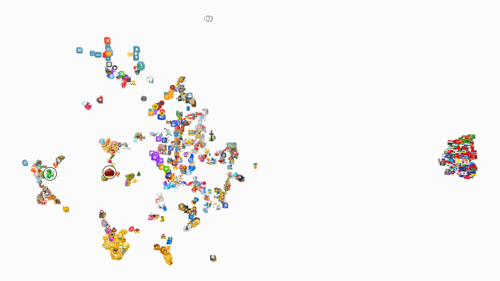

Shares 62% of each emoji's nearest neighbours with the blended descriptions; its map keeps 56%.

**🌰 chestnut.** The chestnut emoji depicts a brown, glossy, roundish nut with a pointed tip and a pale spot, classified as a nut or seed-based food. From a taxonomic standpoint it belongs to the food-vegetable subgroup, grouped with other plant-derived edibles rather than animals or manufactured goods. Its closest siblings in the classification are other nuts and seeds such as the peanut, along with edible plant parts like the potato and the chestnut's own family of harvest foods.

Keywords: chestnut, nut, seed, plant, food, autumn, edible, tree.

- 🥜 sibling nut in the same food category
- 🥔 plant-derived root vegetable in food-vegetable group
- 🍄 foraged autumn food from the forest
- 🌳 chestnuts grow on trees in the plant group
- 🎃 seasonal autumn harvest food
- 🌾 grain and seed crops from the plant kingdom

Nearest by these descriptions: 🥜 🫘 🍒 🥥 🍓 🥔 🥕 🫛

**🐉 dragon.** The dragon emoji depicts a mythical, serpentine creature with wings, horns, and a long tail, classified as a fantasy creature rather than a real animal. In the Unicode taxonomy it sits in the Animals & Nature group under animal-reptile, grouped with real reptiles despite being mythological. Its closest siblings are the other legendary creatures and reptiles such as the crocodile, lizard, and sauropod-like dinosaurs.

Keywords: mythical creature, reptile, fantasy, legend, wings, serpent, animal-reptile, mythology.

- 🦎 reptile sibling in the animal-reptile category
- 🐊 large reptile sibling, real-world counterpart in scale
- 🦕 prehistoric reptile, dragons often evoke dinosaurs
- 🦖 dinosaur sibling sharing a large reptilian form
- 🐍 serpentine reptile sharing the snake-like body
- 🧚 fairy tale creature sharing the fantasy category

Nearest by these descriptions: 🐲 🦄 🐍 🦎 🐸 🦖 🐦‍🔥 🐊

## Chef

> Think like a cook. What role could this play in a kitchen, a dish, a meal or a market, even loosely or metaphorically?

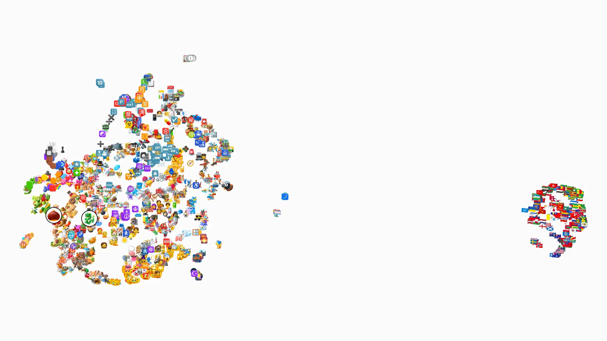

Shares 49% of each emoji's nearest neighbours with the blended descriptions; its map keeps 44%.

**🌰 chestnut.** The chestnut is a roasting staple of winter street carts and holiday markets, where its glossy shell is scored and the nut is charred until sweet and floury. In a kitchen it gets puréed into soups, folded into stuffings, or candied for desserts. It rewards a cook who respects its tough shell and short window of freshness.

Keywords: roast, winter, chestnut, stuffing, market, autumn, purée, street food.

- 🔥 roasted over open fire on street carts
- 🍠 sweet starchy root cooked similarly in autumn dishes
- 🎃 autumn squash paired in harvest soups and pies
- 🍲 puréed into warming winter soups and stews
- 🦃 classic stuffing ingredient for holiday roast
- 🍯 candied or glazed for sweet holiday desserts

Nearest by these descriptions: 🍠 🛷 🍐 🎃 🍒 🌨️ 🧣 🌲

**🐉 dragon.** From a chef's viewpoint, the dragon is a fiery showpiece: it evokes the dramatic flambé, the tableside torch, and the smoky char that a cook draws out of a grill or salamander. Its scaly, fire-breathing persona suggests bold spice, like a fiery chili-laced sauce that roars on the palate. It also belongs to the fairytale feast, a banquet centerpiece sculpted from sugar or served under a dramatic cloche.

Keywords: flambé, fire, showpiece, smoky, spicy, banquet, centerpiece, feast.

- 🔥 dragon's breath becomes the flambé flame
- 🌶️ fiery heat of chili brings the dragon's bite
- 🍖 roasted meat fit for a dragon's feast
- 🍰 fairytale banquet dessert with dramatic presentation
- 🍷 bold wine to pair with a fireside feast
- 🥩 charred cut ready for the grill's flame
- 🍯 sweet glaze for a fairytale centerpiece

Nearest by these descriptions: 🐲 🪋 🧨 ♌ 🎆 ☄️ 🀄 🪄

## Naturalist

> Think like a botanist, zoologist and geologist. Where does this exist in nature, what lives with it, eats it, grows from it or is made of it?

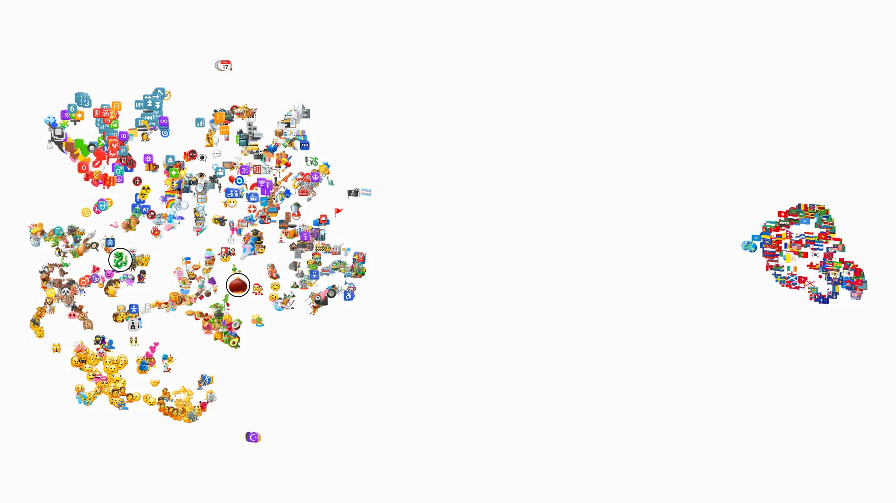

Shares 51% of each emoji's nearest neighbours with the blended descriptions; its map keeps 47%.

**🌰 chestnut.** The chestnut emoji depicts the glossy brown nut of the chestnut tree (genus Castanea), which grows inside a spiny green burr that splits open when ripe in autumn. Squirrels, jays, and deer gather these starchy nuts, and fallen husks feed decomposers in temperate forest floors. Sweet chestnuts were a staple food for many European and Asian communities for centuries.

Keywords: chestnut, nut, tree, burr, autumn, squirrel, forest, Castanea.

- 🌳 chestnut nuts grow on large deciduous trees
- 🐿️ squirrels cache chestnuts for winter food
- 🍂 chestnuts drop from trees as leaves fall in autumn
- 🍄 fungi decompose fallen chestnut husks on the forest floor
- 🦌 deer forage on fallen chestnuts in autumn woodland
- 🌲 both are tree-bearing seed plants in temperate forests

Nearest by these descriptions: 🎄 🌲 🍄‍🟫 🌳 🪵 🐿️ 🍂 🍁

**🐉 dragon.** The dragon is a mythical reptile, so the naturalist's view starts with real reptiles it draws on: lizards, crocodilians and snakes with scaled skin, clawed feet and fire-breathing myths inspired by bombardier beetles and gas-venting creatures. Dragon legends often coil around caves, mountains and hoards of gold, the same places where real reptiles bask on warm rock and where mineral deposits form. Folklore dragons were said to guard eggs and treasure, much like real animals that defend nests and dens. Its shape borrows from fossil finds of dinosaurs and the bones that early people may have mistaken for monstrous creatures.

Keywords: reptile, scales, cave, fossil, myth, lizard, hoard, mountain.

- 🦎 real scaly reptile that inspired dragon imagery
- 🐊 living crocodilian with armored, dragon-like scales
- 🦕 dinosaur fossils fueling dragon legends
- 🐍 serpentine reptile sharing coiling dragon form
- 🌋 volcanic fire linked to dragon breath myths
- 🪨 rock caves where dragons lair and reptiles bask
- 💎 crystals and gems formed underground, like dragon hoards

Nearest by these descriptions: 🐲 🀄 🧚 👺 🦎 🧜 🕴️ 🦄

## Five-year-old

> Answer as an enthusiastic five-year-old: simple words, what it reminds you of, what it is for, what is fun or scary about it.

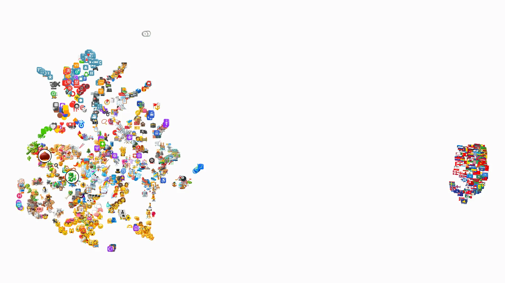

Shares 55% of each emoji's nearest neighbours with the blended descriptions; its map keeps 45%.

**🌰 chestnut.** Wow, it's a chestnut! It looks like a little brown acorn wearing a pointy hat, or a tiny brown bean that fell off a tree. My grandpa says you have to cook them over a fire, and then they get warm and yummy, but you must never eat the shell! It's a super cool treat that grows on trees in autumn.

Keywords: brown, tree, nut, autumn, roast, yummy, acorn, shell.

- 🌳 chestnuts grow on big tall trees
- 🔥 you roast chestnuts over a warm fire
- 🍂 chestnuts fall down in autumn leaves
- 🥜 another crunchy nut you can snack on
- 🐿️ squirrels love to eat and hide nuts

Nearest by these descriptions: 🍂 🥜 🥥 🍄‍🟫 🍁 🥦 🤎 🫘

**🐉 dragon.** Wow, a dragon! It is a big, scary green lizard with pointy spikes on its back and wings that go flap flap! I think it breathes fire, whoosh, like a super hot campfire, and it sleeps in a giant cave full of shiny gold coins. Dragons are my favorite part of fairy tales, but I hope the brave knight wins!

Keywords: dragon, fire, wings, scary, fairy tale, gold, cave, roar.

- 🔥 dragons breathe fire that is super hot and whooshy
- 🏰 dragons live near castles in fairy tales
- ⚔️ brave knights with swords come to fight dragons
- 🦖 both are big scary reptiles with lots of teeth
- 💰 dragons sleep on piles of shiny treasure
- 🧙 wizards in stories make magic with dragons
- 🦅 both have big wings that flap up in the sky

Nearest by these descriptions: 🐲 🏴󠁧󠁢󠁷󠁬󠁳󠁿 🧚 ❤️‍🔥 🐦‍🔥 🏰 🧝 🧙

## Texting and internet slang

> Describe how people actually use this emoji in messages and online, including double meanings, memes, irony and innuendo kept tasteful.

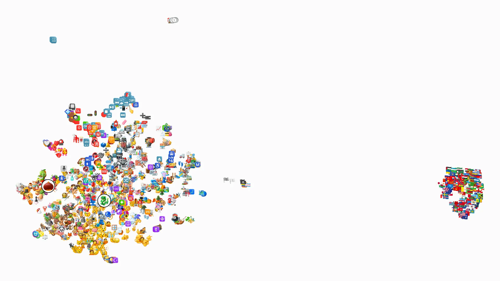

Shares 52% of each emoji's nearest neighbours with the blended descriptions; its map keeps 38%.

**🌰 chestnut.** The chestnut emoji is rarely used literally in texting; its main role is as a stand-in for 'nut' or 'nuts,' so people use it to joke about being nuts, going nuts, or 'you're nuts' in a playful way. It also gets used as a seasonal autumn signal, paired with fall or holiday vibes, and sometimes as a cute, slightly silly reaction to something chestnut-brown or to someone who is 'a nutty one.' Its shape also invites a light bit of innuendo about nuts, though it is mostly used innocently.

Keywords: nuts, crazy, autumn, fall vibes, nutty, silly, seasonal, roasting.

- 🤪 Both used to signal being wild or nutty
- 🍂 Autumn vibes shared with falling leaves
- 🥜 Peanut as a related nut joke
- 🎃 Shared fall and harvest season messaging
- 🔥 Roasting chestnuts over an open fire
- 🤯 Going nuts or mind blown reaction

Nearest by these descriptions: 🥜 🍂 🔩 🍒 🍩 🍠 🍓 🦪

**🐉 dragon.** In texting, the dragon often stands in for raw intensity or chaos, as in 'that was a dragon move' or someone being 'in their dragon era.' It also shows up in gaming and fantasy memes, where it signals epic power-ups, D&D nights, or a 'dragon energy' confidence vibe. Some people use it as a playful stand-in for Chinese New Year or a mythic reaction to something overwhelming. Paired with fire or sword emojis, it reads as hype or a dramatic showdown.

Keywords: dragon, gaming, fantasy, hype, epic, meme, chaos, dnd.

- 🔥 dragon breathing fire signals hype or intensity
- ⚔️ dragon versus knight makes a dramatic showdown
- 🏰 dragons guard castles in fantasy memes
- 🎲 dragon encounters during tabletop roleplay nights
- 🧙 wizards and dragons frequently share fantasy jokes
- 💀 dragon slayers and 'I'm dead' reactions to epic moments

Nearest by these descriptions: 🐲 🀄 🚀 🐅 🌪️ 🧙 🏰 🐯

## Emotional vibe

> Describe the mood, feeling and energy this emoji carries, and which situations or emotional moments it fits.

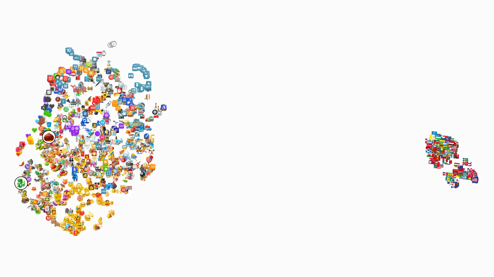

Shares 44% of each emoji's nearest neighbours with the blended descriptions; its map keeps 41%.

**🌰 chestnut.** The chestnut carries a cozy, rustic, autumnal mood, evoking crisp air, roasting fires, and the slow comfort of seasonal traditions. Its glossy brown shell feels humble and grounded, suggesting patience and quiet warmth rather than excitement. It fits moments of nostalgia, holiday gatherings, and simple pleasures shared with others on a cold evening.

Keywords: cozy, autumn, rustic, warmth, nostalgia, comfort, humble, seasonal.

- 🍂 fallen autumn leaves share the same cozy seasonal feeling
- 🔥 roasting chestnuts over a fire brings warmth and comfort
- 🎃 both evoke the spooky-cozy spirit of fall celebrations
- ☕ a warm drink pairs with a quiet, cozy autumn moment
- 🍁 maple leaves capture the same crisp autumn nostalgia
- 🎄 chestnuts are a classic holiday treat for winter gatherings

Nearest by these descriptions: 🍁 🍠 🍄 🤎 🍄‍🟫 🍢 🪵 🍐

**🐉 dragon.** The dragon carries a fierce, mythic energy, suggesting raw power, danger, and untamed excitement. It feels like an epic adventure moment, the thrill of facing a daunting challenge or a legendary foe. Its mood blends menace with wonder, fitting moments of bold confidence, fantasy escapism, or playful fire-breathing bravado.

Keywords: fierce, mythic, adventure, power, bold, fantasy, thrill, menace.

- 🏰 dragons guard castles in fairytale legends
- ⚔️ knights battle dragons in heroic quests
- 🔥 dragons breathe fire, unleashing fiery energy
- 🧙 wizards summon and command mythical dragons
- 🦖 both are giant fearsome reptilian creatures
- 💎 dragons hoard treasure and precious gems

Nearest by these descriptions: 🐲 🐅 🫍 🐯 🚵 🦈 🌩️ ⚡

## Seasons and holidays

> Place this in time: seasons, months, holidays, festivals, times of day and recurring life events it belongs to.

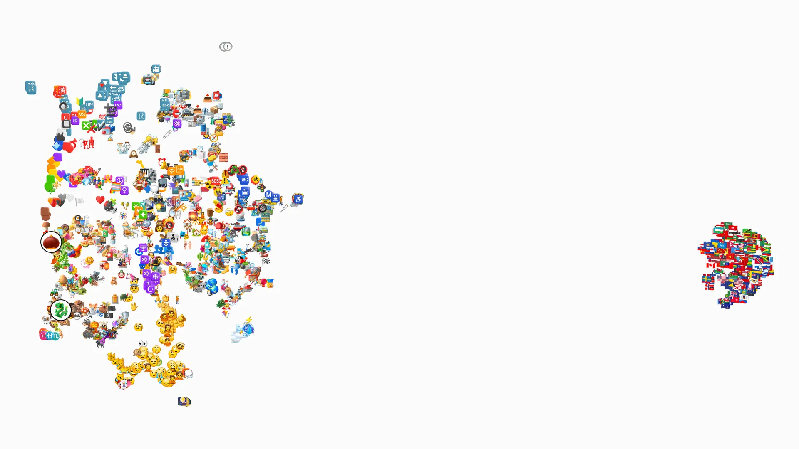

Shares 53% of each emoji's nearest neighbours with the blended descriptions; its map keeps 46%.

**🌰 chestnut.** The chestnut emoji is strongly tied to autumn, when chestnuts ripen and fall from trees and are gathered in September and October. It is a classic cold-weather treat, roasted over open fires and sold from street carts in winter. In many European traditions it marks the start of the cozy season around Halloween and Thanksgiving-style harvest gatherings.

Keywords: autumn, fall, harvest, winter, roasting, October, seasonal, cozy.

- 🍂 fallen autumn leaves where chestnuts drop
- 🎃 Halloween harvest season when chestnuts are roasted
- 🍁 maple leaf marks the same autumn season
- 🔥 roasting chestnuts over an open fire in winter
- 🦃 autumn harvest feast with seasonal side dishes
- ⛄ winter cold season when chestnuts are sold warm

Nearest by these descriptions: 🍂 🤎 🍐 🟤 🍁 🥜 🍄 🦃

**🐉 dragon.** The dragon is strongly tied to Lunar New Year in East Asian tradition, where dragon dances and dragon motifs mark the festivities and the years of the Dragon in the zodiac cycle. It also belongs to European midsummer and folk festival imagery, such as St. George's Day legends, and to Halloween and fantasy celebrations where mythical creatures appear. Seasonally it fits the lively, festive spirit of the Lunar New Year period in late winter.

Keywords: lunar new year, zodiac, dragon dance, festival, st george, folklore, halloween, spring festival.

- 🧧 red envelopes given during Lunar New Year celebrations
- 🎆 fireworks lighting up Lunar New Year festivities
- 🏮 lanterns decorating Lunar New Year and Lantern Festival
- 🎉 party celebrations marking festive holiday occasions
- 🎃 Halloween, when fantasy creatures and folklore feature
- 🐲 face of the dragon in Chinese zodiac celebrations

Nearest by these descriptions: 🐲 🐅 🧨 🐯 🏮 🐰 🐵 🐖

## Japanese origin

> Many emoji began on Japanese mobile carriers. Describe any Japanese cultural meaning, origin or usage of this emoji, or how a Japanese viewer might read it.

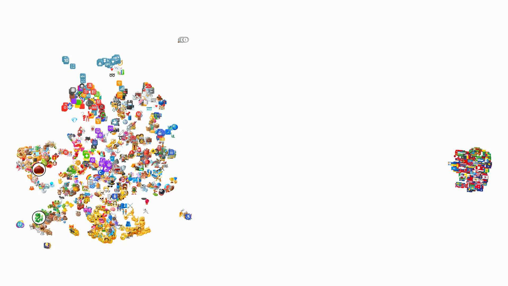

Shares 55% of each emoji's nearest neighbours with the blended descriptions; its map keeps 42%.

**🌰 chestnut.** The chestnut is a beloved autumn treat in Japan, known as kuri, and roasted chestnuts sold from street carts called yaki-guri are a classic seasonal sight in cities during cooler months. Chestnuts also feature prominently in Japanese confectionery such as kuri kinton and mont blanc-style sweets, and in rice dishes like kuri gohan. The phrase kuri-iro evokes the warm brown of the nut, and the fruit is tied to the traditional seasonal eating culture of aki.

Keywords: kuri, yaki-guri, autumn, aki, kuri-gohan, wagashi, roasted, seasonal.

- 🍠 Autumn root vegetables sold together in seasonal Japanese fare
- 🍂 Fallen leaves signal the autumn season when chestnuts ripen
- 🍁 Maple leaves celebrated alongside chestnuts during Japanese autumn foliage season
- 🍡 Sweet dango and wagashi often feature chestnut flavors
- 🍚 Chestnut rice, kuri gohan, is a classic autumn dish
- 🎃 Autumn seasonal festivity shared with Halloween imagery

Nearest by these descriptions: 🍄 🍠 🍄‍🟫 🍰 🥒 🦪 🍒 🍁

**🐉 dragon.** In Japan the dragon (ryū, 竜/龍) is a revered, auspicious creature tied to water, rain, and rivers, rather than the fearsome fire-breathing monster of Western tales. Japanese viewers often associate it with the Chinese-derived zodiac sign of Tatsu, the fifth animal, and with Shinto and Buddhist lore such as dragon kings guarding the sea. Because the carrier-era emoji was drawn in a Western fantasy style, Japanese users may read it as a playful nod to fantasy anime and games like Dragon Quest rather than a sacred symbol.

Keywords: ryu, tatsu, zodiac, water god, rain, dragon quest, auspicious, anime.

- 🐍 Snake shares Japanese zodiac and serpentine myth roots
- 🌧️ Dragons in Japanese lore summon rain and storms
- 🌊 Dragon kings in Japanese myth rule the sea
- ⛩️ Shrines honor dragon deities tied to water
- 🎌 Dragons appear in Japanese folklore and national imagery
- 🎮 Dragon Quest and Japanese games popularize dragons

Nearest by these descriptions: 🐲 🦁 🌪️ 🐯 🐅 🐍 🦖 🐓

## Cross-cultural meanings

> Describe how the meaning or connotation of this emoji differs across cultures, regions, languages or religions around the world.

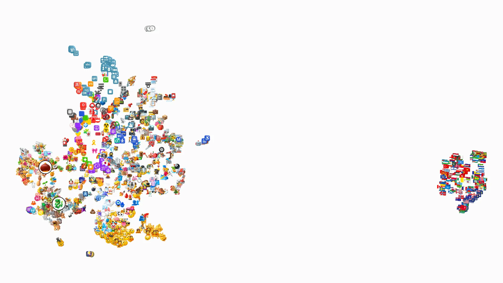

Shares 57% of each emoji's nearest neighbours with the blended descriptions; its map keeps 45%.

**🌰 chestnut.** The chestnut carries strong seasonal and cultural weight in many parts of the world. In Italy, France, and Portugal, roasted chestnuts sold from street carts signal winter and holiday warmth, and chestnut flour underpins traditional dishes in Corsica and parts of Liguria. In Japan, chestnuts (kuri) are a celebrated autumn delicacy and appear in sweets like kuri kinton, while in China they symbolize prosperity and are a traditional gift for newlyweds, since their Mandarin name sounds like 'early son'. In parts of Korea, chestnuts are offered at ancestral rites, reflecting their ceremonial importance.

Keywords: chestnut, autumn, winter, roasting, prosperity, tradition, kuri, holiday.

- 🍂 fallen leaves share the autumn harvest season
- 🎃 both mark autumn festivals and seasonal celebrations
- 🍁 maple leaves evoke autumn foliage where chestnuts ripen
- 🔥 roasting chestnuts over an open fire
- 🍠 roasted sweet potato, another street-cart winter snack
- 🎄 chestnuts are a traditional holiday treat

Nearest by these descriptions: 🦪 🪎 🍒 🍪 🍠 🌲 🍂 🍐

**🐉 dragon.** In Western fantasy the dragon is usually a fearsome, greedy monster that hoards gold and must be slain by knights, but in China and much of East Asia it is a benevolent, auspicious creature tied to rain, water, imperial power, and good fortune. Chinese New Year dragon dances and the zodiac dragon are celebrated, and people born in the dragon year are often considered especially lucky. This contrast means the same emoji can signal danger in one culture and prosperity in another, so context matters when using it with East Asian audiences.

Keywords: China, zodiac, auspicious, fantasy, East Asia, luck, monster, Lunar New Year.

- 🎍 bamboo often paired with dragon motifs for Lunar New Year luck
- 🧧 red envelopes given during dragon-themed Lunar New Year celebrations
- 🐲 face variant of the dragon, used for Chinese-style dragons
- 🏮 lanterns decorate festivals where dragon dances are performed
- ⚔️ crossed swords evoke Western knights slaying dragons
- 🔥 fire breath is the Western dragon's signature threat

Nearest by these descriptions: 🐲 🐵 🐀 🐯 🀄 🦄 🐦‍🔥 🐭

## Storyteller

> Imagine the fairy tales, fables, films and scenes in which this appears. What happens around it, who is there, and what comes next?

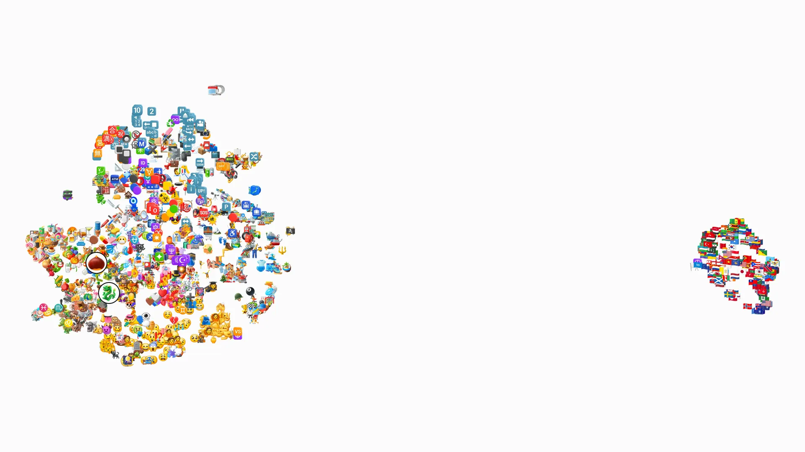

Shares 49% of each emoji's nearest neighbours with the blended descriptions; its map keeps 42%.

**🌰 chestnut.** A chestnut sits in a storybook as the humble treasure of a squirrel's autumn larder or a forest child's pocket on a cold harvest evening. In fables it often marks the moment a small, overlooked creature proves its worth, like the woodland hero who roasts chestnuts over a crackling fire to share with friends. Around it gather hedgehogs, owls, and grandmothers wrapped in scarves, telling tales by the hearth. What comes next is usually a warm winter feast or a cozy night of stories.

Keywords: autumn, forest, squirrel, harvest, hearth, fable, winter, treasure.

- 🐿️ squirrel gathers chestnuts for its winter stash
- 🔥 chestnuts are roasted over a crackling fire
- 🍂 fallen leaves carpet the forest where chestnuts drop
- 🦔 hedgehog shares the woodland harvest with friends
- 🦉 wise owl watches over the autumn forest tale
- 🍁 maple leaves signal the same crisp autumn scene
- 🏡 cozy home where the chestnuts are shared

Nearest by these descriptions: 🌳 🐿️ 🫘 🍂 🍁 🍄‍🟫 🛖 🟤

**🐉 dragon.** The dragon is the fearsome beast of old fairy tales, coiled atop a gold hoard in a cave while villagers tremble below. Knights ride out to face it, and the story turns on whether courage, cunning, or a princess's kindness can topple the monster. Often it breathes fire over the castle walls before the final duel. In the aftermath, the tale closes with a slain beast or a reformed, friendly dragon.

Keywords: dragon, fairy tale, knight, hoard, quest, castle, princess, legend.

- 🏰 dragons guard or terrorize the castle in tales
- 🤴 a prince sets out to slay the dragon
- 👸 the princess is rescued from the dragon's lair
- ⚔️ a knight's sword is needed to defeat the beast
- 🔥 the dragon's fiery breath scorches the village
- 💰 the dragon hoards gold in its cave
- 🧙 a wizard grants the hero a spell against the dragon
- 🏆 the victorious hero is celebrated with a reward

Nearest by these descriptions: 🐲 💎 🏰 🌋 💰 🛡️ 👱 👸

## Punster

> Find wordplay: puns, homophones, idioms, sayings, rhymes and figures of speech connected to this emoji or its name.

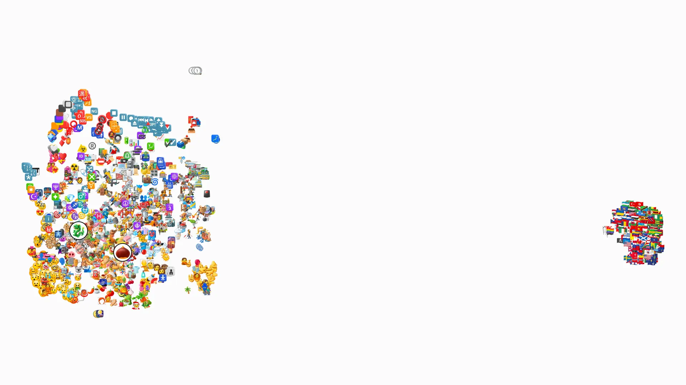

Shares 52% of each emoji's nearest neighbours with the blended descriptions; its map keeps 37%.

**🌰 chestnut.** The chestnut emoji invites wordplay around the word 'chestnut', which doubles as a slang term for an old joke or a worn-out story, as in 'that's an old chestnut.' Its shape also suggests a nut in a spiky shell, and 'chestnut' is a homophone-style pun on 'chest nut' or 'chess nut' for players of the board game. The brown color lends itself to 'chestnut horse' and the idiom 'pull someone's chestnuts out of the fire,' meaning to rescue them from trouble.

Keywords: old chestnut, pull chestnuts from fire, chess nut, chest nut, nutty, roasting, brown, idiom.

- 🔥 Pull chestnuts out of the fire idiom
- 🎭 Old chestnut as a worn-out stage joke
- ♟️ Homophone pun: chess nut
- 🥜 Nut family wordplay on a nutty idea
- 🐴 Chestnut horse, a reddish-brown coat
- 🍂 Autumn season when chestnuts fall

Nearest by these descriptions: 🪎 🔩 🥥 🐿️ 🥜 🤎 🪵 🪡

**🐉 dragon.** The dragon invites plenty of wordplay: 'dragging' your feet sounds like 'dragon' feet, and 'don't let the dragon in' is a joke about being a 'drag-on' bore. The idiom 'dragged out' and 'a dragon of a day' stretch the sound into everyday speech. Its fiery breath also fuels the phrase 'breathing fire,' which punsters love to pair with 'dragon' and 'fly by night' rhymes.

Keywords: dragon, drag on, pun, fire breath, idiom, homophone, fairytale, wordplay.

- 🔥 Dragons breathe fire, and 'breathing fire' is an idiom for fierce anger
- 🐍 Snake sounds like 'snake in the grass' and dragons share the serpent kinship
- 🦖 Dragon and dinosaur, a pun on 'dino-dragon' and reptile roots
- 🏰 Castle, where a dragon is said to be kept in fairytale idioms
- ⚔️ Swords, as in 'dragon slayer' idiom and the knight-versus-dragon saying
- 🥚 Egg, as in 'dragon egg' and 'walking on eggshells' wordplay
- 🚶 Walking, as in 'dragging your feet' sounds like a dragon walking

Nearest by these descriptions: 🐲 🪰 🐸 🔥 🫁 🦆 🏴󠁧󠁢󠁷󠁬󠁳󠁿 🐦

## Historian

> Describe the history of the thing depicted and of its name: origins, etymology, notable historical moments and how its meaning changed.

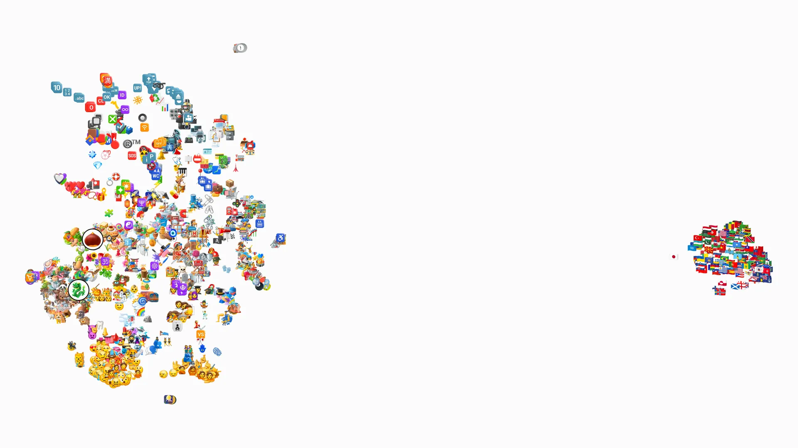

Shares 58% of each emoji's nearest neighbours with the blended descriptions; its map keeps 43%.

**🌰 chestnut.** The chestnut emoji depicts the glossy brown nut still partly wrapped in its spiky husk, a food that has nourished people since prehistory. The English word traces back through Middle English 'chesteine' and Old French 'chastaigne' to Latin 'castanea' and Greek 'kastanon', likely borrowed from an Anatolian region near Castana. Sweet chestnuts were a staple flour crop across Mediterranean Europe for centuries, earning the tree the nickname 'bread tree', before potatoes and maize displaced them. Roasting chestnuts became a winter street tradition in cities like Paris and London, which is why the nut is strongly tied to cold-season memories.

Keywords: chestnut, history, etymology, bread tree, Castana, winter roast, staple food, Mediterranean.

- 🌳 chestnut is the tree that bears these nuts
- 🥜 both are nuts eaten as a staple food
- 🍂 chestnuts fall in autumn and are gathered then
- 🔥 roasting over fire created the winter chestnut tradition
- 🍞 chestnut flour once served as bread in lean years
- 🌾 grains and chestnut flour were both historic staples

Nearest by these descriptions: 🍒 🧈 🍞 🧣 🫜 🧀 🥙 🥞

**🐉 dragon.** The dragon emoji depicts a green, winged, serpentine creature, a figure rooted in ancient myth across many cultures. The word comes from the Greek drakon, meaning serpent or large snake, which passed into Latin and then Old French and English. In European medieval romance and chivalric legend, dragons became fearsome foes slain by heroes like Saint George, while in East Asian tradition the dragon was often a benevolent, auspicious power linked to rain and imperial authority. Its Unicode form is a Western-style fire-breathing dragon, reflecting the medieval European image more than the Chinese one.

Keywords: dragon, myth, etymology, drakon, chivalry, legend, serpent, fairytale.

- 🐲 face variant of the same mythic creature
- 🐍 dragon name derives from Greek word for serpent
- 🏰 castles were the typical dwelling of medieval dragons
- ⚔️ knights slaying dragons form a chivalric tradition
- 🧙 wizards and dragons recur together in fantasy legend
- 🔥 dragons are traditionally imagined breathing fire
- 🎋 Chinese dragon lore tied to rain and good fortune

Nearest by these descriptions: 🐲 🐍 🦢 🗡️ 🧙 🦄 🏴󠁧󠁢󠁷󠁬󠁳󠁿 🐸

## Material and senses

> Describe how it would feel, smell, sound, taste and weigh: texture, temperature, hardness, materials and physical sensations.

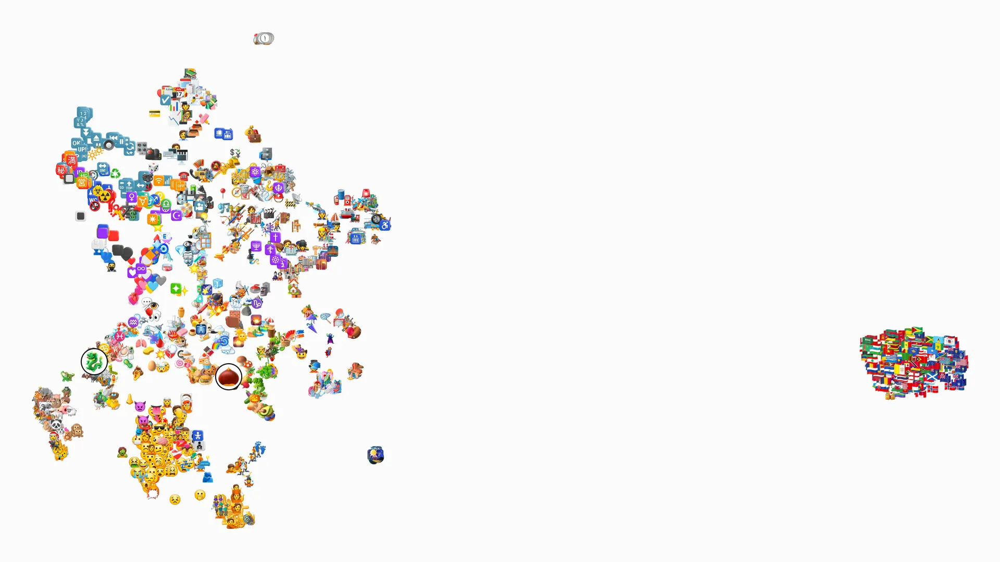

Shares 47% of each emoji's nearest neighbours with the blended descriptions; its map keeps 44%.

**🌰 chestnut.** A chestnut feels smooth and glossy under the fingers at first, then reveals a rough, leathery shell that is hard and slightly dented. Its brown skin is dry and papery, and when roasted it turns warm, soft, and floury, with a faintly sweet, smoky aroma. The nut is dense and heavy for its size, cracking open with a satisfying snap.

Keywords: glossy, hard shell, warm, floury, roasted, smoky aroma, dense, brown.

- 🔥 roasting over fire makes the shell crack and split
- 🍂 dry fallen leaves crunch alongside chestnuts in autumn
- 🌳 chestnuts grow on tall, sturdy trees
- 🥜 both are hard-shelled nuts with a dense, oily kernel
- 🍠 roasted starchy food with a soft, sweet, floury texture
- 🧺 gathered chestnuts are carried home in a basket

Nearest by these descriptions: 🥜 🫘 🍠 🥚 🍫 🍖 🥥 🥔

**🐉 dragon.** From a material and sensory viewpoint, the dragon feels like scaled green-gold armor: each scale is hard, ridged, and slightly warm, like sun-baked stone or hammered bronze. Its wings would be leathery and taut, and its breath would smell of sulfur, smoke, and hot ash. Imagine the rumble of its body in the chest and the crackle of heat rising from its throat.

Keywords: scales, leathery, sulfur, smoke, warm, armor, bronze, rumble.

- 🔥 dragon breath produces fierce scorching fire
- 🪨 hard scales feel like rough, heavy stone
- ⚔️ knights clash steel against dragon scales
- 🥚 dragon eggs are hard, warm, and rare
- 💎 dragon hoards gleaming gems and gold treasure
- 🌋 sulfurous heat and smoke evoke volcanic lands

Nearest by these descriptions: 🐲 🐦‍🔥 🦇 🪲 👿 🐍 🦂 🐊

## Scale and physics

> Describe its size, mass, speed, energy and physical behaviour, and what it is comparable to in scale, from atoms to galaxies.

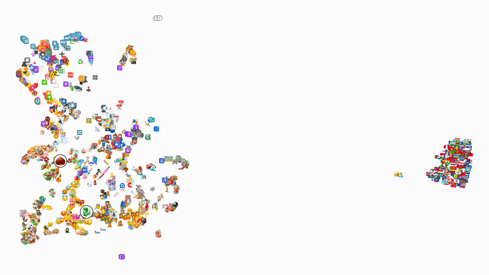

Shares 45% of each emoji's nearest neighbours with the blended descriptions; its map keeps 45%.

**🌰 chestnut.** Viewed through scale and physics, a chestnut is a dense, roughly centimetre-to-few-centimetre nut with a hard shell that protects a starchy kernel, typically weighing around 5 to 15 grams. Its size places it between a pea and a golf ball, and it is many millions of times larger than a single atom but tiny compared with a tree or a planet. When dropped from a tree, a chestnut falls at terminal velocity of only a few metres per second because of its small mass and air resistance, and its hard husk absorbs the impact energy. Its seed-dispersal behaviour relies on gravity, and the spiky burr casing can explode open from the energy stored in the drying tissue.

Keywords: centimetre, gravity, density, terminal velocity, seed mass, impact energy, scale, burr.

- 🌳 chestnut falls from a tree under gravity
- 🍂 fallen chestnuts drift down through the autumn air
- 🌑 a chestnut is tiny compared with the Moon's scale
- ⚛️ a nut is built from atoms, far smaller in scale
- 🔥 roasting releases stored energy and pops the shell
- 🍁 autumn seeds and leaves both fall with gravity

Nearest by these descriptions: 🥜 🍒 🥥 🍐 🌸 🍂 🫐 🍊

**🐉 dragon.** Viewed through scale and physics, the dragon is a fictional creature whose imagined size could range from a house to a mountain, so its mass would be on the order of tens of thousands of kilograms or more. Its wings would need enormous lift and power, and a body that heavy would struggle to fly under real gravity, making it a thought experiment in biomechanics and energy budgets. Compared with real animals, it sits near the largest land creatures, yet it still dwarfs a human as a tiny fraction of a galaxy-scale universe.

Keywords: mass, wingspan, gravity, lift, fire energy, scale, fiction physics, biomechanics.

- 🔥 breathing fire releases enormous chemical energy as heat
- 🦖 real giant reptiles show the mass limits of land animals
- 🪽 wings must generate lift against the dragon's body weight
- 🌋 volcanic eruptions rival a dragon's fiery energy output
- ☄️ a comet's impact energy dwarfs any creature's power
- 🚀 rockets escape gravity with thrust a dragon's wings cannot match

Nearest by these descriptions: 🐲 🧚 🦩 🧛 🪰 🧙 🐔 🦅

## Trade and economy

> Describe where it comes from economically: who makes, grows, sells or buys it, its value, supply chains, industries and money around it.

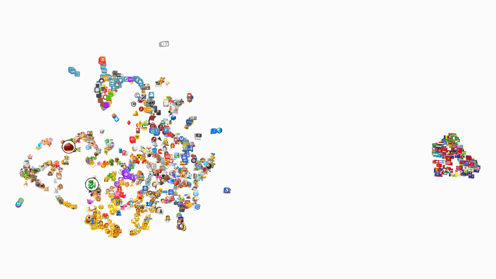

Shares 51% of each emoji's nearest neighbours with the blended descriptions; its map keeps 48%.

**🌰 chestnut.** The chestnut is a nut harvested mainly from orchards in China, Italy, Turkey, Spain and South Korea, where it is a seasonal cash crop for smallholder farmers. Fresh chestnuts are traded in autumn and winter markets, often roasted and sold from street carts, while dried, canned, and puréed forms supply confectionery and baking industries, including the French marron glacé trade. Global chestnut prices swing with harvest yields, making the nut a modest but volatile commodity in agricultural markets.

Keywords: chestnut, orchard, commodity, seasonal harvest, roasted nuts, agriculture export, confectionery, street vendor.

- 🌾 grain and nut crops share agricultural commodity markets
- 🍯 chestnut honey is a specialty product from chestnut groves
- 🍬 chestnuts feed the candied sweets trade like marron glacé
- 🛒 sold at markets and grocery shelves as a seasonal purchase
- 💰 seasonal harvest prices determine farmer income
- 🚜 orchard harvesting relies on farm machinery and labor

Nearest by these descriptions: 🍒 🥜 🍑 🍊 🌲 🍐 🍫 🥥

**🐉 dragon.** The dragon has no physical supply chain, but its economy is large in fantasy markets: tabletop role-playing manuals, fantasy novels, film franchises, and collectible figurines carved in resin or cast in pewter. Dragon-themed merchandise, games, and streaming content generate substantial revenue, and the creature serves as a licensed brand mascot for studios and publishers. Its image also drives tourism and souvenir trade in places that claim legendary dragon lore.

Keywords: merchandise, fantasy market, collectibles, role-playing games, film franchise, licensing, tourism, publishing.

- 🏰 castle-themed fantasy tourism and souvenir trade
- 🎲 dice and tabletop role-playing game market
- 📚 fantasy book publishing and bestseller sales
- 🎬 fantasy film franchises and box office revenue
- 🧙 wizard characters sold in fantasy merchandise lines
- 💰 treasure hoard as money won through dragon-themed markets
- ⚔️ knightly sword replicas traded among fantasy collectors
- 🎮 dragon-themed video games driving entertainment sales

Nearest by these descriptions: 🐲 🧌 🧙 🧝 🧚 🧜 🦖 🧞

## Game designer

> Imagine it in a video game or board game: is it an item, enemy, power-up, location, character or resource, and what does it do?

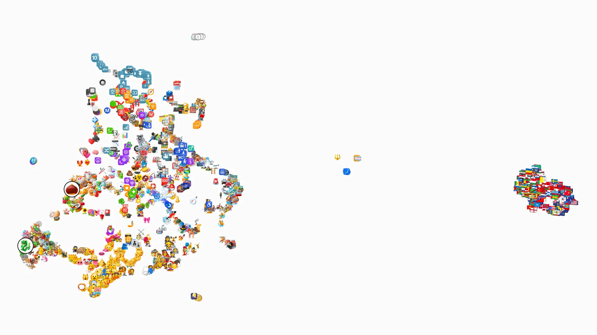

Shares 52% of each emoji's nearest neighbours with the blended descriptions; its map keeps 46%.

**🌰 chestnut.** As a game item, the chestnut is a common crafting resource harvested from trees or forage spots, often used to cook roasted food or brew simple potions. It could serve as a low-tier consumable that restores a small amount of health or stamina when roasted over a campfire. In a survival game, a stack of chestnuts might also be bartered to traders or tossed as a throwable distraction item.

Keywords: resource, forage, crafting, consumable, roasting, stamina, trade, tree.

- 🔥 roasting chestnuts requires a campfire or fire source
- 🍳 cooking station turns raw chestnuts into a meal
- 🌳 chestnuts are harvested from chestnut trees
- 🧺 gathered chestnuts are stored in a forager's basket
- 🍂 fallen leaves mark the autumn gathering season
- 🧪 chestnut extract can be brewed into a stamina potion

Nearest by these descriptions: 🍠 🥜 🥔 🥥 🍲 🥄 🫓 🍞

**🐉 dragon.** From a game design standpoint, the dragon is a classic boss enemy or late-game threat, typically guarding a treasure hoard or a castle. It works well as a high-health, multi-phase encounter with fire breath attacks and flight that can shift the battle arena. Defeating it could unlock a legendary weapon, a rare mount, or a major story reward.

Keywords: boss, enemy, fire breath, hoard guardian, mount, legendary.

- 🔥 dragon breath deals fire damage to players
- 💎 dragon hoards gems as its treasure drop
- 🏰 dragon guards castle as a dungeon boss
- ⚔️ heroes must draw swords to defeat the dragon
- 🛡️ shields help players survive dragon fire attacks
- 🥚 dragon egg can hatch into a tamable mount
- 🧙 wizard NPC offers quests to slay the dragon

Nearest by these descriptions: 🐲 🐻 🐦‍🔥 🦄 🦏 🧌 🐘 🦖

## Poet

> Describe its symbolism and metaphors: what it stands for in poetry, art and dreams, and what deeper ideas it evokes.

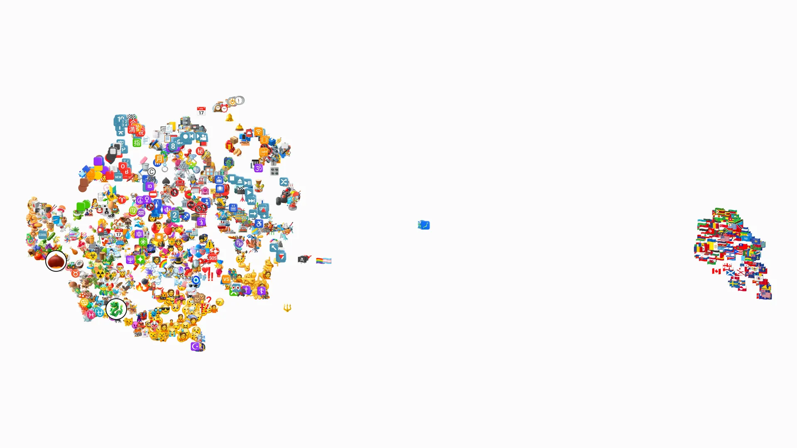

Shares 48% of each emoji's nearest neighbours with the blended descriptions; its map keeps 40%.

**🌰 chestnut.** The chestnut is a quiet emblem of hidden treasure, sheltered within a spiky burr and a hard glossy shell until the right moment of opening. Poets have long seen it as a symbol of patient autumn abundance, of warmth gathered for the cold months, and of the modest gift that rewards careful searching. Its rough outer husk against the smooth brown nut suggests the way tender things are often guarded by a prickly exterior, inviting the reader to look beneath surfaces.

Keywords: hidden treasure, autumn, patience, shelter, harvest, warmth, modest gift, inner sweetness.

- 🍂 fallen autumn leaves cradle the ripening harvest season
- 🌳 chestnuts grow on a tree rooted in time
- 🔥 roasted chestnuts bring warmth to cold nights
- 🍁 maple and chestnut share the poetry of October
- 🌾 grain and nut both gather the bounty of harvest
- 🕯️ a candle glow echoes the hearth-side chestnut evening

Nearest by these descriptions: 🪎 🍐 🥜 🦪 🥑 🥕 🍯 🍠

**🐉 dragon.** The dragon is a poet's creature of guarded treasure and untamed power, a serpent that carries fire within it and rules the hoard of unspoken wealth. In poetry and dreams it stands for the terrifying threshold we must cross before reaching what we most desire, the shadow the hero must face. Its wings suggest the soul's longing to rise, while its coiled body hints at the mystery of the unconscious, the hidden fire beneath the scales.

Keywords: threshold, shadow, hoard, fire, myth, transformation, guardian, ascent.

- 🔥 dragon's breath carries the fire of passion and transformation
- 🏰 dragons guard castles and the treasures within their walls
- 🗡️ the knight's sword is the hero's answer to the dragon
- 🦄 fabled opposites, the dragon's fury meets the unicorn's purity
- 🌙 dreams and night myths where serpents of the unconscious stir
- 💎 the hoard the dragon guards holds glittering jewels

Nearest by these descriptions: 🐲 🧌 🔥 🐍 👸 🛡️ 🐆 🐦‍⬛

## Jobs and workplaces

> Describe which professions, workplaces, tools of the trade and daily work routines involve this.

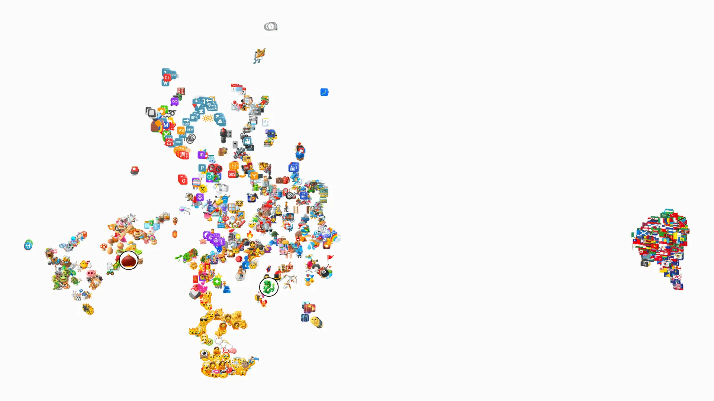

Shares 55% of each emoji's nearest neighbours with the blended descriptions; its map keeps 48%.

**🌰 chestnut.** The chestnut emoji fits jobs connected to agriculture, orchards, and food production, where chestnuts are harvested, sorted, and roasted. Roasting vendors on city streets and farm workers in autumn harvests use them as a daily product. Chefs and bakers use chestnuts in soups, stuffings, and desserts, and forestry workers may encounter them in chestnut groves.

Keywords: harvest, orchard, farming, roasting, vendor, forestry, chef, autumn.

- 🌾 harvested alongside other crops during autumn farm work
- 🔥 roasting chestnuts over an open fire on street carts
- 🧑‍🌾 farmer who gathers chestnuts from orchard trees
- 🌳 chestnut trees grown and managed in orchards and forests
- 👨‍🍳 chef who cooks chestnuts into soups and desserts
- 🧺 basket used to collect and carry harvested chestnuts

Nearest by these descriptions: 🍒 🥜 🥕 🌲 🍠 🫒 🍓 🥥

**🐉 dragon.** From a jobs and workplaces viewpoint, the dragon appears in fantasy-industry work such as illustration, concept art, game design, and film visual effects, where artists sketch and render dragon creatures. Tabletop game masters and fantasy novelists also build dragon characters into their campaigns and stories. Workers in theme parks and costume departments may craft dragon props, puppets, or mascots for live performances.

Keywords: concept artist, game design, VFX, illustration, fantasy author, game master, costume maker, theme park.

- 🎨 artists paint and sketch dragon concept art
- 🎮 game designers create dragon bosses and encounters
- 🎬 film VFX teams animate dragon creatures on screen
- 🖌️ illustrators draw dragons for books and covers
- 📚 fantasy authors write dragon-filled stories
- 🎲 game masters run dragon battles in tabletop campaigns
- 🏰 castle-themed theme park attractions feature dragons

Nearest by these descriptions: 🐲 🧚 🧌 🧛 🪄 🧝 👺 🧟

## Sports and play

> Describe connections to sports, games, hobbies, toys, competitions and leisure activities.

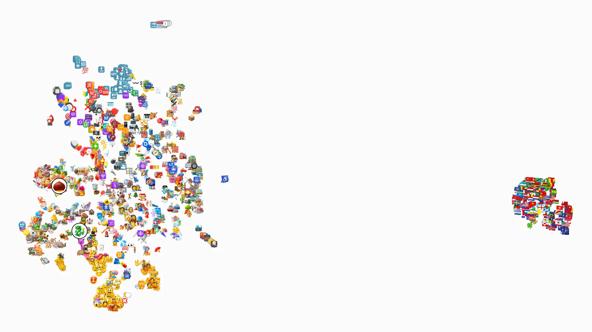

Shares 54% of each emoji's nearest neighbours with the blended descriptions; its map keeps 44%.

**🌰 chestnut.** The chestnut is a glossy brown nut that, from a sports and play angle, evokes the classic game of conkers, where children thread a chestnut on a string and smash it against an opponent's nut. Roasted chestnuts also feature in winter festivals and holiday markets, where people gather for seasonal fun and games. Its shiny, round shape makes it a favorite of autumn walks and playground collecting contests.

Keywords: conkers, autumn, playground, game, toss, festival, collecting, string.

- 🌳 chestnut trees shade parks where conkers are played
- 🍂 fallen leaves mark autumn conker season outdoors
- 🎃 autumn festivities bring games and seasonal fun
- 🪀 both are simple toys swung or thrown on a string
- 🎄 winter holiday markets sell roasted chestnuts for festive play
- 🥜 nuts are shelled and played with in snack-based games

Nearest by these descriptions: 🍂 🍩 🍒 🌽 🧀 🐓 🍁 🍄‍🟫

**🐉 dragon.** The dragon is a fixture of fantasy games and tabletop play, where it often serves as the final boss a party must defeat in a campaign. It appears in video game quests, collectible card games, and role-playing adventures as a fearsome opponent or treasure guardian. Toy dragons and plush collectibles also reflect its popularity among hobbyists and young players.

Keywords: tabletop, boss battle, role-playing, quest, card game, fantasy game, collectible, treasure hoard.

- 🎲 dragons are iconic foes in dice-based tabletop role-playing games
- ⚔️ heroes draw swords to battle dragons in quests
- 🎮 dragon bosses are staples of video game adventures
- 🏆 slaying a dragon earns a legendary victory trophy
- 🧩 puzzle-solving quests often guard against dragons
- 🛡️ knights wear armor to defend against dragon attacks

Nearest by these descriptions: 🐲 🧌 🧝 🦄 🀄 🪄 🦖 🦕

## Body and health

> Describe connections to the human body, health, medicine, nutrition, fitness, illness and wellbeing.

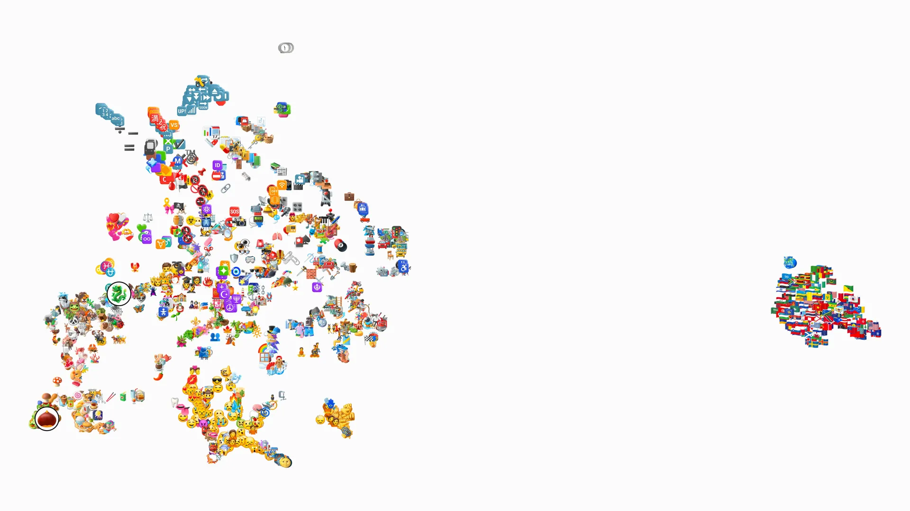

Shares 53% of each emoji's nearest neighbours with the blended descriptions; its map keeps 47%.

**🌰 chestnut.** The chestnut emoji shows a glossy brown nut with a pointed tip, often in its spiky husk context. From a body and health viewpoint, chestnuts are a starchy, low-fat nut rich in complex carbohydrates, vitamin C, and potassium, making them a relatively gentle energy source for the body. Roasted chestnuts are often eaten as a wholesome seasonal snack, and their fiber supports healthy digestion.

Keywords: nutrition, carbohydrates, fiber, digestion, vitamin C, potassium, energy, healthy snack.

- 🥜 Another nut offering protein and healthy fats for the body
- 🥔 Starchy whole food providing steady carbohydrate energy
- 🍠 Fiber-rich root vegetable that supports digestive health
- 🥗 Balanced salad pairing nuts with fresh vegetables
- 🫘 Legume packed with plant protein and fiber
- 🍎 Fresh fruit that complements a nutritious snack

Nearest by these descriptions: 🍠 🥕 🫜 🍞 🍐 🌾 🥭 🥔

**🐉 dragon.** The dragon is a mythical reptile, so from a body and health viewpoint it evokes scales, claws, wings and the fire-breathing imagery tied to inflammation or heat. It is often used playfully to represent a fierce or fiery bodily state, like a burning fever or a roaring appetite. Its reptilian form also connects to skin care and the anatomy of scaled creatures, though the creature itself is fictional.

Keywords: reptile, scales, fever, fire, myth, anatomy, skin, fierce.

- 🦎 real reptile with scales, like the dragon's skin
- 🌡️ fiery heat evokes a feverish body temperature
- 🔥 fire-breathing imagery linked to burning inflammation
- 🦖 prehistoric reptile sharing the dragon's scaled body
- 🐍 another scaled reptile tied to skin and anatomy
- 🤒 fever-like heat sometimes described with fiery imagery

Nearest by these descriptions: 🐲 🔥 ♏ 🐍 🐊 🧌 🧞 🐢

## Where you would find it

> Describe where you would find it: which room of a house, which part of a city or landscape, which building, shop or vehicle.

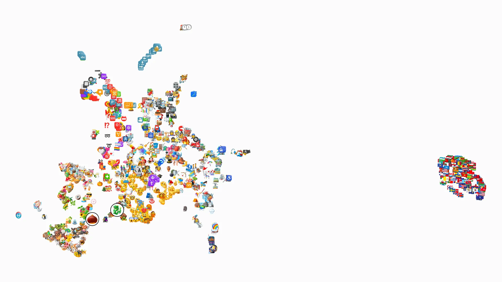

Shares 54% of each emoji's nearest neighbours with the blended descriptions; its map keeps 49%.

**🌰 chestnut.** A chestnut is most likely found outdoors, in a park, forest, or along a tree-lined street where chestnut trees grow, especially in autumn when spiny burrs drop and split open. It also turns up in a kitchen or at a street-food cart, where roasted chestnuts are sold in paper cones during winter. Look for it on the ground under trees or in a market stall piled with nuts.

Keywords: forest, park, autumn, tree, roasting cart, market, orchard, winter.

- 🌳 chestnut trees grow in parks and forests
- 🍂 chestnuts fall to the ground in autumn
- 🍁 autumn leaves surround the fallen chestnuts
- 🌲 chestnuts gather in woodland among evergreens
- 🥜 both are nuts sold at markets and kitchens
- 🍄 mushrooms and chestnuts are foraged on forest floors

Nearest by these descriptions: 🪾 🍂 🌳 🍄 🌲 🎄 🍁 🐿️

**🐉 dragon.** From a location viewpoint, the dragon would be found in fairytale settings: inside a castle's highest tower, in a dark cave beneath a mountain, or guarding a treasure hoard in a storybook illustration. It also appears in theme parks, fantasy bookshops, and medieval festival grounds. Look for it where knights, princesses, and legends are kept alive.

Keywords: cave, castle, tower, fairytale, storybook, mountain, treasure, fantasy.

- 🏰 dragons often guard or terrorize castles in tales
- ⚔️ knights traditionally battle dragons in legends
- 🗡️ a dagger or sword used to slay dragons
- 👸 princesses are often held captive by dragons
- 🧙 wizards conjure or tame dragons in fantasy stories
- 💎 gems form the treasure dragons hoard in caves
- 🌋 volcanoes evoke the lairs where dragons live

Nearest by these descriptions: 🐲 🏰 👸 🦄 🧚 🧌 🤴 🧞

## Free word association

> Play a fast word-association game: describe the chain of first things that spring to mind, however surprising.

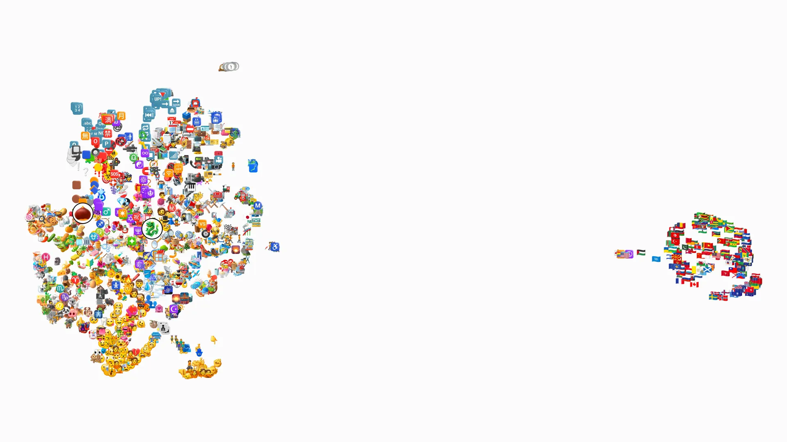

Shares 54% of each emoji's nearest neighbours with the blended descriptions; its map keeps 42%.

**🌰 chestnut.** The chestnut emoji brings to mind autumn streets, the smell of roasting over a cart, and crackling fires on cold nights. Its glossy brown shell makes me think of conkers, a childhood game of string and swinging nuts. Then my thoughts drift to Christmas, chestnuts roasting on an open fire, and to hedgehogs, who seem to share its spiky-brown vibe. It feels cozy, seasonal, and a little bit nostalgic.

Keywords: autumn, roasting, conker, winter, nut, cozy, hedgehog, fire.

- 🍂 fallen autumn leaves season the chestnut belongs to
- 🔥 chestnuts are roasted over an open fire
- 🎄 roasting chestnuts are a classic Christmas image
- 🦔 spiky brown shell evokes a hedgehog's prickly coat
- 🌳 chestnuts grow on large deciduous trees

Nearest by these descriptions: 🍠 🍂 🐿️ 🧡 🎄 🤎 🎃 🌲

**🐉 dragon.** Dragon brings to mind fire breathing, then treasure hoards, then castles and knights, then a sleepy cave full of gold coins. My chain jumps quickly from scaly wings to Smaug to birthday cakes with candles, since dragons seem to be everywhere in fantasy. The green face and spiky back make it feel both ancient and a little silly.

Keywords: fire, wings, treasure, castle, myth, scales, cave, legend.

- 🔥 dragons breathe fire in fantasy stories
- 🏰 dragons guard castles and keeps
- 💰 dragons hoard gold and treasure in caves
- 🦖 both are giant scaly reptilian creatures
- ⚔️ knights battle dragons in legends
- 🧙 wizards often summon or tame dragons

Nearest by these descriptions: 🐲 🏰 👸 🤴 🀄 🧙 🏴󠁧󠁢󠁷󠁬󠁳󠁿 🦄

---

This page and its maps are generated from the pipeline's data by a script; see [the viewpoints page](../development.md#the-viewpoints-page) in the development notes.
